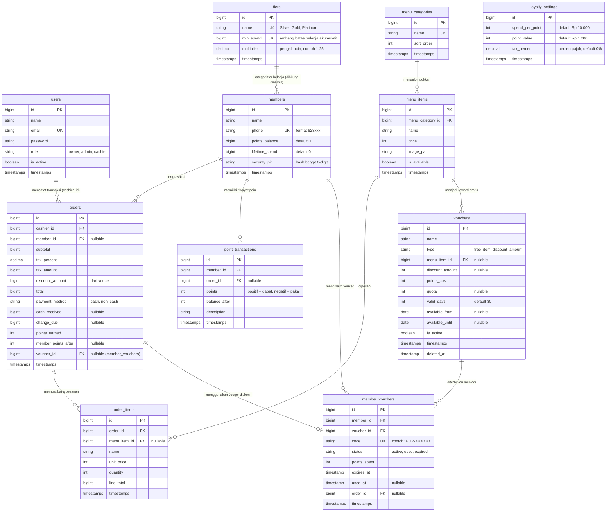

# Dokumentasi Sistem Digital Loyalty & POS Soho Coffee

Dokumentasi teknis arsitektur, struktur direktori, alur bisnis, basis data, dan panduan operasional aplikasi **Soho Coffee - Digital Loyalty & POS**.

---

## 1. Ikhtisar Sistem

Sistem ini adalah aplikasi terintegrasi berbasis web yang menggabungkan dua fungsi utama untuk operasional cafe:
1. **Point of Sale (POS) & Backoffice Admin**: Digunakan oleh staf kasir, manajer/admin, dan pemilik (*owner*) untuk mencatat transaksi penjualan, mengelola katalog menu, memantau laporan pendapatan, serta mengonfigurasi aturan loyalitas.
2. **Customer Loyalty App (PWA)**: Aplikasi web ramah ponsel (*mobile-first*) dengan dukungan *Progressive Web App* yang diakses pelanggan untuk melihat saldo poin, tingkat keanggotaan (*tier*), riwayat belanja, penukaran voucer reward, dan pengelolaan PIN keamanan.

### Lingkungan dan Spesifikasi Teknologi
- **Bahasa & Runtime**: PHP 8.3+
- **Kerangka Kerja**: Laravel 12 (framework 12/13.x)
- **Basis Data**: MySQL (Database engine default `april_ui_testing`)
- **Frontend Web**: Blade Templates, Tailwind CSS v4, Alpine.js 3.17, April UI component library, Lucide Icons (`mallardduck/blade-lucide-icons`)
- **Gateway Pihak Ketiga**: Fonnte WhatsApp API (`https://api.fonnte.com/send`) untuk pengiriman kode OTP verifikasi
- **Pengujian (Testing)**: Pest PHP 4.x (Unit & Feature), Node.js native test runner untuk utilitas JavaScript kasir
- **PWA**: Web App Manifest (`public/manifest.json`) dan Service Worker cache (`public/sw.js`)

---

## 2. Struktur Direktori Proyek

Berikut susunan berkas dan fungsi direktori utama dalam repositori:

```text
.
├── app/
│   ├── Http/
│   │   ├── Controllers/
│   │   │   ├── Admin/                # Controller panel administratif (dashboard, menu, tier, voucer, staf, laporan)
│   │   │   │   ├── DashboardController.php
│   │   │   │   ├── LoyaltySettingController.php
│   │   │   │   ├── MemberController.php
│   │   │   │   ├── MenuCategoryController.php
│   │   │   │   ├── MenuItemAvailabilityController.php
│   │   │   │   ├── MenuItemController.php
│   │   │   │   ├── ReportController.php
│   │   │   │   ├── StaffController.php
│   │   │   │   ├── TierController.php
│   │   │   │   └── VoucherController.php
│   │   │   ├── Auth/                 # Autentikasi sesi staf internal
│   │   │   │   └── SessionController.php
│   │   │   ├── Customer/             # Controller portal pelanggan (login OTP, dompet voucer, PIN, reward)
│   │   │   │   ├── AuthController.php
│   │   │   │   ├── DashboardController.php
│   │   │   │   ├── HistoryController.php
│   │   │   │   ├── PinController.php
│   │   │   │   ├── RewardController.php
│   │   │   │   └── VoucherWalletController.php
│   │   │   ├── Pos/                  # Endpoint pendukung kasir (pencarian member, lookup voucer, simpan order)
│   │   │   │   ├── MemberController.php
│   │   │   │   ├── OrderController.php
│   │   │   │   └── VoucherController.php
│   │   │   ├── Controller.php
│   │   │   ├── HomeController.php    # Router pengarah staf berdasarkan perannya
│   │   │   └── PosController.php     # Halaman utama aplikasi kasir
│   │   ├── Middleware/
│   │   │   └── EnsureUserHasRole.php # Filter otorisasi berbasis peran (owner, admin, cashier)
│   │   ├── Requests/                 # Form request validation per use-case
│   │   │   ├── IndexMenuItemsRequest.php
│   │   │   ├── IndexStaffRequest.php
│   │   │   ├── LoginRequest.php
│   │   │   ├── LookupMemberRequest.php
│   │   │   ├── LookupVoucherRequest.php
│   │   │   ├── LoyaltySettingRequest.php
│   │   │   ├── MemberRequest.php
│   │   │   ├── MenuCategoryRequest.php
│   │   │   ├── MenuItemRequest.php
│   │   │   ├── OrderRequest.php
│   │   │   ├── StaffRequest.php
│   │   │   ├── TierRequest.php
│   │   │   └── VoucherRequest.php
│   │   └── Resources/
│   │       └── MemberResource.php    # JSON Resource data member untuk kasir
│   ├── Models/                       # Model Eloquent ORM
│   │   ├── LoyaltySetting.php
│   │   ├── Member.php
│   │   ├── MemberVoucher.php
│   │   ├── MenuCategory.php
│   │   ├── MenuItem.php
│   │   ├── Order.php
│   │   ├── OrderItem.php
│   │   ├── PointTransaction.php
│   │   ├── Tier.php
│   │   ├── User.php
│   │   └── Voucher.php
│   ├── Policies/
│   │   └── UserPolicy.php            # Kebijakan otorisasi pengelolaan akun staf
│   ├── Providers/
│   │   └── AppServiceProvider.php
│   ├── Services/
│   │   └── FonnteService.php         # Klien HTTP pengiriman pesan WhatsApp OTP via Fonnte API
│   ├── Support/                      # Kelas bantuan umum
│   │   ├── Percent.php
│   │   ├── PhoneNumber.php           # Normalisasi nomor HP Indonesia (format 628xx)
│   │   └── Rupiah.php                # Pemformatan mata uang IDR
│   ├── PaymentMethod.php             # Enum metode bayar: cash, non_cash
│   ├── Role.php                      # Enum peran staf: owner, admin, cashier
│   └── VoucherType.php               # Enum tipe voucer: free_item, discount_amount
├── bootstrap/
│   ├── app.php                       # Konfigurasi routing, middleware, dan exception handling Laravel
│   └── providers.php
├── config/
│   ├── app.php                       # Konfigurasi zona waktu (Asia/Jakarta) dan locale (id)
│   ├── auth.php                      # Guard staf (web -> User) dan pelanggan (customer -> Member)
│   ├── database.php
│   ├── services.php                  # Konfigurasi kredensial Fonnte WhatsApp token
│   └── ...
├── database/
│   ├── factories/                    # Factory untuk data pengujian
│   ├── migrations/                   # Skrip pembuatan dan modifikasi tabel basis data
│   └── seeders/                      # Data awal (StaffSeeder, LoyaltySeeder, MenuSeeder)
├── diagrams/                         # Berkas diagram arsitektur PlantUML (*.puml) dan gambar (*.png)
│   ├── 1_transaksi_pos.puml
│   ├── 2_klaim_voucer.puml
│   ├── 3_login_otp.puml
│   └── 4_daftar_member_kasir.puml
├── docs/                             # Dokumentasi proyek
│   └── DOKUMENTASI.md
├── public/
│   ├── icons/                        # Ikon PWA dan logo aplikasi
│   ├── manifest.json                 # Web App Manifest konfigurasi PWA
│   └── sw.js                         # Service worker untuk caching aset statis
├── resources/
│   ├── css/
│   │   └── app.css                   # Konfigurasi Tailwind CSS v4
│   ├── js/
│   │   ├── app.js                    # Inisialisasi Alpine.js dan plugin
│   │   ├── pos-math.js               # Kalkulasi harga, pajak, dan poin di sisi kasir
│   │   ├── pos-register.js           # Logika interaktif keranjang belanja kasir
│   │   └── theme-switcher.js         # Pengatur tema gelap/terang
│   └── views/
│       ├── admin/                    # Template panel admin (dashboard, master data, laporan)
│       ├── auth/                     # Template login staf
│       ├── components/               # Komponen Blade reusable (layout, sidebar, avatar, modal PWA)
│       ├── customer/                 # Template antarmuka pelanggan (login OTP, dompet, reward, pin)
│       └── pos/                      # Template antarmuka kasir dan cetak nota
├── routes/
│   ├── console.php                   # Definisi perintah artisan kustom
│   └── web.php                       # Seluruh rute web aplikasi
└── tests/
    ├── Feature/                      # Pengujian integrasi fungsional (Admin, Auth, Pos, Customer)
    ├── Unit/                         # Pengujian unit logic PHP dan pengujian Node.js untuk JS kasir
    └── Pest.php
```

---

## 3. Desain Basis Data & Model Relasional

Aplikasi menggunakan dua guard autentikasi terpisah:
1. `User` (tabel `users`): akun internal untuk staf cafe (Owner, Admin, Kasir).
2. `Member` (tabel `members`): akun pelanggan yang bertransaksi dan mengumpulkan poin.

### Skema Tabel Utama



---

## 4. Alur Kerja Inti Aplikasi

### A. Autentikasi Pelanggan (WhatsApp OTP via Fonnte)
1. Pelanggan membuka rute `/app/login` dan memasukkan nomor WhatsApp.
2. `PhoneNumber::normalize()` merapikan nomor HP ke format baku Indonesia (`628...`).
3. Sistem membuat kode acak 4 digit angka (`random_int(1000, 9999)`) dengan masa aktif 5 menit.
4. `FonnteService::sendOTP()` mengirimkan pesan WhatsApp ke nomor pelanggan via API Fonnte dengan proteksi *timeout* 25 detik dan *auto-retry* 2 kali.
5. Sesi login menyimpan waktu jeda pengiriman ulang (cooldown 60 detik).
6. Di halaman `/app/otp`, pelanggan memasukkan 4 digit kode. Jika benar:
   - Jika member sudah terdaftar: langsung masuk (*authenticated*).
   - Jika member baru: dibuatkan baris baru di tabel `members` secara otomatis.
   - Sesi di-generate ulang (`session()->regenerate()`) untuk keamanan.

### B. Transaksi Kasir (POS) & Penukaran Voucer
1. Kasir membuka `/pos`, memilih item menu ke keranjang belanja.
2. Jika pelanggan adalah member:
   - Kasir mengetik nomor WhatsApp untuk mencari data member (`/pos/members/lookup`).
   - Kasir juga dapat mendaftarkan member baru secara langsung dari modal kasir tanpa mengganggu antrean pesanan.
3. Jika member ingin menukarkan voucer yang dimiliki:
   - Kasir memasukkan kode voucer member (format `KOP-XXXXXX`).
   - Sistem memvalidasi kepemilikan voucer, masa berlaku, status aktif, dan keberadaan PIN keamanan member.
   - Member wajib memasukkan 6-digit PIN Keamanan mereka di layar kasir.
4. Kasir memilih metode pembayaran (Tunai / Non-Tunai):
   - Jika tunai: kasir menginput uang diterima, sistem menghitung uang kembalian.
5. Pengiriman pesanan diproses di dalam transaksi basis data (`DB::transaction`):
   - Memeriksa ketersediaan menu (jika ada yang habis, transaksi dibatalkan).
   - Mengunci baris member dan voucer (`lockForUpdate`) untuk menghindari duplikasi klaim.
   - Mengurangi nilai voucer dari subtotal belanja: `min(benefitAmount, subtotal)`.
   - Menghitung perolehan poin: `(subtotal / spend_per_point) * tier_multiplier`.
   - Memperbarui akumulasi belanja member (`lifetime_spend`) dan saldo poin (`points_balance`).
   - Menyimpan rekaman order (`orders`), baris pesanan (`order_items`), dan mutasi poin (`point_transactions`).
   - Mengubah status voucer menjadi `used`.
6. Kasir diarahkan ke halaman cetak struk nota transaksi (`/pos/orders/{order}`).

### C. Alur Klaim Voucer Hadiah oleh Member
1. Pelanggan membuka tab **Rewards** (`/app/rewards`).
2. Sistem menampilkan daftar voucer promosi yang statusnya aktif dan berada dalam rentang tanggal berlaku (`Voucher::openForClaims()`).
3. Member menekan tombol **Klaim**:
   - Sistem mengunci data voucer dan member via transaksi database.
   - Memastikan sisa kuota voucer masih tersedia (`quota > 0`).
   - Memastikan saldo poin member mencukupi (`points_balance >= points_cost`).
   - Saldo poin dipotong dan kuota voucer dikurangi.
   - Baris `PointTransaction` bertanda minus dicatat sebagai riwayat penukaran.
   - Diterbitkan kode unik voucer baru (`KOP-` + 6 karakter alfanumerik) pada tabel `member_vouchers` dengan masa berlaku sesuai konfigurasi `valid_days`.
4. Voucer tersimpan di menu **Kupon Saya** (`/app/vouchers`) dan siap digunakan saat bertransaksi di kasir.

### D. Perhitungan Poin Loyalty & Kenaikan Tier Dinamis
- **Perhitungan Poin**:
  Dihitung menggunakan rumus bilangan bulat:
  $$\text{Poin} = \left\lfloor \frac{\text{Subtotal}}{\text{spend\_per\_point}} \right\rfloor \times \frac{\text{Multiplier Hundredths}}{100}$$
  *Contoh*: Belanja Rp 55.000 dengan aturan Rp 10.000 = 1 poin pada Tier Gold (multiplier 1.25):
  $$\text{Poin} = 5 \times 1.25 = 6{,}25 \rightarrow 6 \text{ poin}$$
- **Tier Keanggotaan**:
  Tier ditentukan dinamis berdasarkan nilai akumulasi belanja pelanggan seumur hidup (`lifetime_spend`), diurutkan dari `min_spend` tertinggi yang sudah terlampaui. Kenaikan tier terjadi otomatis tanpa perlu proses batch terpisah.

---

## 5. Matriks Hak Akses & Peran Pengguna (RBAC)

Sistem membedakan hak akses berdasarkan peran akun internal dan guard pelanggan:

| Modul / URL | Owner | Admin | Kasir (Cashier) | Pelanggan (Member) |
| :--- | :---: | :---: | :---: | :---: |
| **Kasir POS** (`/pos`) | Akses Nota | Ya | Ya | Tidak |
| **Pencarian & Registrasi Member di Kasir** (`/pos/members/*`) | Tidak | Ya | Ya | Tidak |
| **Simpan Pesanan POS** (`/pos/orders`) | Tidak | Ya | Ya | Tidak |
| **Dashboard Metrik Admin** (`/admin`) | Ya | Ya | Tidak | Tidak |
| **Laporan Penjualan** (`/admin/reports`, `/admin/reports/print`) | Ya | Ya | Ya | Tidak |
| **Kelola Member & Penyesuaian Poin** (`/admin/members/*`) | Tidak | Ya | Tidak | Tidak |
| **Kelola Menu & Kategori** (`/admin/categories`, `/admin/menu-items`) | Tidak | Ya | Tidak | Tidak |
| **Ubah Status Ketersediaan Menu** (`/admin/menu-items/{id}/availability`) | Tidak | Ya | Tidak | Tidak |
| **Kelola Tier Loyalitas** (`/admin/tiers/*`) | Tidak | Ya | Tidak | Tidak |
| **Kelola Master Voucer** (`/admin/vouchers/*`) | Tidak | Ya | Tidak | Tidak |
| **Konfigurasi Aturan Poin & Pajak** (`/admin/loyalty`) | Tidak | Ya | Tidak | Tidak |
| **Kelola Akun Staf** (`/admin/staff/*`) | Tidak | Ya (kecuali Owner) | Tidak | Tidak |
| **Aplikasi Pelanggan PWA** (`/app/*`) | Tidak | Tidak | Tidak | Ya |

---

## 6. Integrasi Eksternal: WhatsApp Fonnte

Pengiriman pesan OTP menggunakan gateway Fonnte dengan arsitektur berikut:
- **Lokasi Layanan**: [app/Services/FonnteService.php](file:///Users/altheria/Project%20Web%20Dev/april-ui-testing/app/Services/FonnteService.php)
- **Konfigurasi Token**: Diatur pada berkas `.env` dengan variabel `FONNTE_TOKEN` dan dipetakan ke `config/services.php` (`services.fonnte.token`).
- **Parameter Request**:
  - URL Endpoint: `https://api.fonnte.com/send`
  - Header: `Authorization: {token}`
  - Form Fields: `target` (nomor tujuan), `message` (isi pesan OTP), `countryCode: 62`.
- **Ketahanan Jaringan**:
  - `connectTimeout(15)`: Waktu tunggu sambungan ditingkatkan hingga 15 detik.
  - `timeout(25)`: Waktu tunggu baca data hingga 25 detik.
  - `retry(2, 500)`: Jika terjadi kegagalan jaringan sementara, sistem otomatis mencoba ulang sebanyak dua kali dengan jeda 500 ms sebelum melemparkan *exception*.
  - Pembersihan pesan error: Pesan teknis cURL diubah menjadi keterangan ramah pengguna tanpa menampilkan jejak internal di antarmuka.
- **Lingkungan Pengujian**: Saat `app()->environment('testing')` aktif, request HTTP dilewati (*bypassed*) dan menghasilkan respons simulasi sukses agar tidak memotong kuota pengiriman pesan.

---

## 7. Panduan Instalasi dan Menjalankan Proyek

### Persyaratan Lingkungan
- PHP 8.3 atau lebih tinggi (ekstensi: `pdo_mysql`, `mbstring`, `openssl`, `curl`, `bcmath`)
- Composer 2.x
- Node.js 20+ dan npm
- Server Basis Data MySQL 8.x atau MariaDB 10.x

### Langkah Instalasi Pertama Kali

1. **Clone repositori dan pasang dependensi:**
   ```bash
   git clone https://github.com/Altheriaa/sim-membership-digital-loyalty-soho-coffee.git
   cd sim-membership-digital-loyalty-soho-coffee
   composer install
   npm install
   ```

2. **Pengaturan variabel lingkungan:**
   Salin berkas konfigurasi default:
   ```bash
   cp .env.example .env
   php artisan key:generate
   ```
   Sesuaikan parameter basis data dan token Fonnte pada berkas `.env`:
   ```env
   DB_CONNECTION=mysql
   DB_HOST=127.0.0.1
   DB_PORT=3306
   DB_DATABASE=april_ui_testing
   DB_USERNAME=root
   DB_PASSWORD=

   FONNTE_TOKEN=isi_token_fonnte_anda_di_sini
   ```

3. **Migrasi dan Pengisian Data Awal (Seeding):**
   ```bash
   php artisan migrate --seed
   ```
   *Catatan*: Seeder membuat 3 akun staf awal untuk tahap pengembangan (semua akun menggunakan kata sandi `password`):
   - **Owner**: `owner@example.com`
   - **Admin**: `admin@example.com`
   - **Kasir**: `kasir@example.com`

4. **Tautan Berkas Penyimpanan (Storage Link):**
   ```bash
   php artisan storage:link
   ```

5. **Menjalankan Server Pengembangan:**
   Gunakan perintah terpadu Laravel 12:
   ```bash
   composer run dev
   # Atau langsung via artisan:
   php artisan dev
   ```
   Perintah ini akan menjalankan secara bersamaan:
   - Server web Laravel (`http://localhost:8000`)
   - Vite dev server untuk aset CSS dan JavaScript
   - Worker antrean latar belakang (`queue:listen`)
   - Pelacak log real-time (`artisan pail`)

6. **Menjalankan Pengujian (Automated Tests):**
   - Jalankan seluruh tes Pest:
     ```bash
     composer test
     ```
   - Jalankan tes unit logika kasir (Node.js):
     ```bash
     node --test tests/Unit/*.test.js
     ```
   - Pemformatan kode sesuai standar PSR/Laravel Pint:
     ```bash
     vendor/bin/pint --format agent
     ```
